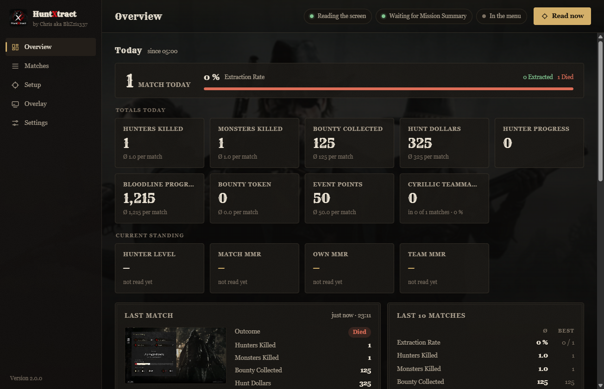

# HuntXtract – Match Tracker for Hunt: Showdown 1896

[](https://github.com/BliZzi1337/HuntXtract/releases/latest)

[](https://github.com/BliZzi1337/HuntXtract/releases/latest)
[](https://www.huntshowdown.com/)
[](https://twitch.tv/blizzi1337)

[](https://steamcommunity.com/id/blizzi1337/)

by Chris aka BliZzi1337 · [Twitch](https://www.twitch.tv/blizzi1337) · [Steam](https://steamcommunity.com/id/blizzi1337/) · Discord: **blizzi1337**

**[⬇ Download the latest version](https://github.com/BliZzi1337/HuntXtract/releases/latest)** · Windows 10/11 · English & Deutsch · free

HuntXtract is a free stats tracker for **Hunt: Showdown 1896**. After every match it reads your
**Mission Summary** straight from the screen (or from your OBS game capture) and keeps track of
kills, bounty, Hunt Dollars, extraction rate, MMR and more – per day, per map and all time.
It never touches the game: no injection, no memory reading, no internet needed. All data stays on your PC.



## Features

- **Automatic match tracking** – recognises the Mission Summary, waits until all points are handed
  out and reads Hunters Killed, Monsters Killed, Bounty Collected, Hunt Dollars, Bloodline and Hunter
  Progress, Event Points and whatever else you mark. Extracted or died is worked out by itself.
- **Team Details & MMR** – Match MMR, your own MMR and your teammates with their stars.
- **Map statistics** – how often you played Stillwater Bayou, Lawson Delta, DeSalle and Mammon's
  Gulch, with extraction rate and averages per map.
- **Trail on the map** – every look at the map (Tab) marks where you were; after the match you see
  your whole route, live during the match too.
- **Hunt status** – reads Hunt's own log: menu, matchmaking, loading, in a match on which map, shooting range.
- **Matchmaking time** – a live clock for the search and the lobby wait ("Searching · 0:21",
  "Lobby found · waiting 0:42"), Ø click-to-match, search and lobby times, lobbies that broke up,
  by time of day – and as a live value for your OBS overlay.
- **Ready-made setup** for 16:9 from 1920 × 1080 upwards (Full HD, 1440p, 4K) in English and German –
  new users usually don't have to draw a single frame.
- **OBS overlays** for streamers – freely designable, as a browser source.
- **In-game countdown** while the summary is being read, six app designs, English and German UI.

## Install

1. [Download](https://github.com/BliZzi1337/HuntXtract/releases/latest) `HuntXtract-x.y.z.zip`.
2. Unzip it and put the **HuntXtract** folder (with **assets** and **Lizenzen**) in a fixed place,
   e.g. `C:\Games\HuntXtract`.
3. Start `HuntXtract.exe` – a short tour walks you through the setup.

Needs Windows 10/11 with the Edge WebView2 Runtime (always included in Windows 11). Hunt should run
in borderless fullscreen. **Update:** copy the new files over the old folder – your matches in
`Daten` stay. The full guide is in `README.txt` (English) and `LIESMICH.txt` (Deutsch) in the ZIP.

**Smart App Control:** the program is not code-signed yet. If Windows Smart App Control blocks it,
that is because of the missing signature, not because of anything in the program.

## Contact & feedback

- Bugs and ideas: [open an issue](https://github.com/BliZzi1337/HuntXtract/issues/new/choose)
- Discord: **blizzi1337**
- Twitch: [twitch.tv/blizzi1337](https://www.twitch.tv/blizzi1337)

---

## Deutsch

**HuntXtract** ist ein kostenloser Match-Tracker für **Hunt: Showdown 1896**. Nach jedem Match liest
es die **Mission Summary** aus – direkt vom Bildschirm oder aus deiner OBS-Spielaufnahme – und führt
Buch über Kills, Bounty, Hunt Dollars, Extraction Rate, MMR und mehr: pro Tag, pro Karte und insgesamt.
Dazu Team Details mit MMR, die Laufspur auf der Karte, Overlays für OBS und eine fertige Einrichtung
für 16:9 ab 1920 × 1080 (Deutsch und Englisch). Kein Eingriff ins Spiel, alle Daten bleiben auf deinem PC.

**Installation:** [Neueste Version herunterladen](https://github.com/BliZzi1337/HuntXtract/releases/latest),
entpacken, den Ordner **HuntXtract** samt **assets** und **Lizenzen** an einen festen Ort legen und
`HuntXtract.exe` starten. Die ausführliche Anleitung steht in `LIESMICH.txt`.

**Kontakt:** Fehler und Ideen gern als [Issue](https://github.com/BliZzi1337/HuntXtract/issues/new/choose),
Discord **blizzi1337**, Twitch [twitch.tv/blizzi1337](https://www.twitch.tv/blizzi1337).

---

## For developers / Für Entwickler

Nur Windows 10/11, kein SDK: `build.ps1` kompiliert mit dem C#-Compiler von .NET Framework 4.8
nach `out\HuntXtract\`.

```powershell
powershell -ExecutionPolicy Bypass -File build.ps1
```

- `src/` – das Programm (C#): Bildquelle (OBS oder Bildschirm), Wiedererkennung, Texterkennung
  mit Windows OCR, Datenhaltung, Fenster; `src/MapTrail.cs` – die Tab-Karte: gelben Punkt
  finden, Zoom am roten Rand oder an gemerkten Kartenbildern erkennen, Laufspur des
  laufenden Matches sammeln; `src/HuntLog.cs` – liest Hunts eigenes Protokoll (`USER\Game.log`,
  über Steam gefunden) für Menü/Match/Karte mit und den Steam-Namen aus `loginusers.vdf`
  (für Tests liest `KOPFGELD_TEST_SCREEN` ein Bild statt des Monitors, `KOPFGELD_TEST_HUNTLOG`
  eine Datei statt des Hunt-Protokolls)
- `web/` – die Oberfläche (HTML/JS/CSS in WebView2) und das OBS-Overlay
  - `web/app/i18n.js` – die englischen Texte (im Code steht Deutsch; `tr`/`t` schlagen nach),
    Flaggen der Sprachauswahl; im C#-Teil stehen beide Sprachen direkt nebeneinander (`Lang.T`)
  - `web/app/themes.css` – die Designs, `web/overlay/overlay.js` – Overlay-Vorlagen und -Darstellung
  - `web/fonts/` – Crimson Text, EB Garamond, Rye (SIL Open Font License, Lizenztexte daneben)
  - `web/img/` – Hintergrundbilder aus dem offiziellen Hunt-Fankit von Crytek
- `art/logo.webp` – das HuntXtract-Logo; `tools/make-icon.ps1` macht daraus `app.ico` und das Zeichen
  in der Seitenleiste (`web/img/logo-mark.png`)
- `tools/make-templates.ps1` – erzeugt aus einer fertigen Einrichtung die Beispielbilder
  (`web/img/vorlage-*.jpg`), Spielernamen verpixelt
- `tools/make-preset.ps1` – erzeugt aus einer fertigen Einrichtung in 1920 × 1080 die Vorgabe
  für neue Nutzer (`web/vorgabe/`, für andere Spielsprachen `web/vorgabe/<sprache>/` wie
  `german`: Kalibrierung und saubere Bilder der drei Seiten, Namen verpixelt). `src/Presets.cs`
  übernimmt sie beim ersten Start, wenn Hunt laut `USER\game.cfg` in 16:9 ab 1920 × 1080 läuft
  und es für die Sprache aus Hunts Protokoll eine Vorgabe gibt
- `vendor/` – die WebView2-Bibliotheken aus Microsofts NuGet-Paket
- `test/` – Testwerkzeuge: nachgebautes OBS (MockObs), OCR-Tests, DevTools-Helfer
- `docs/` – Bilder für diese Seite
- `LIESMICH.txt` / `README.txt` – die Anleitung für Nutzer (Deutsch / Englisch)

Fan project, not affiliated with Crytek. / Fan-Projekt, nicht mit Crytek verbunden.
